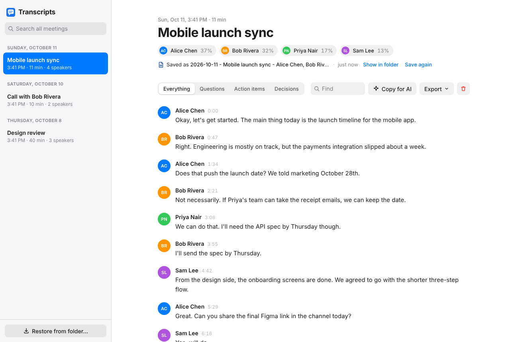
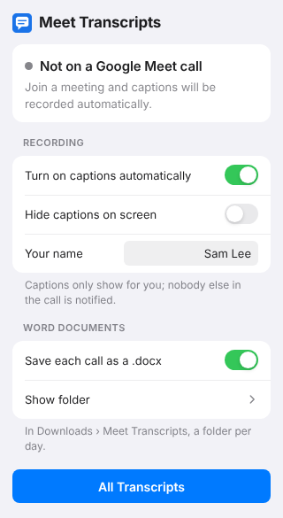
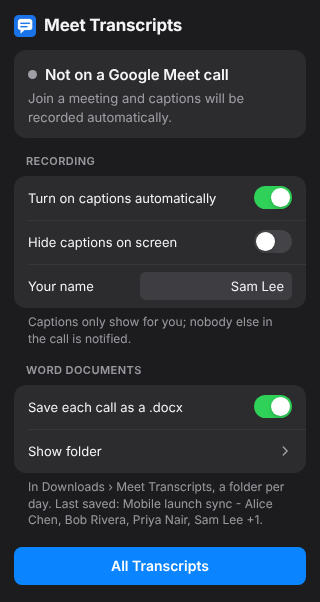
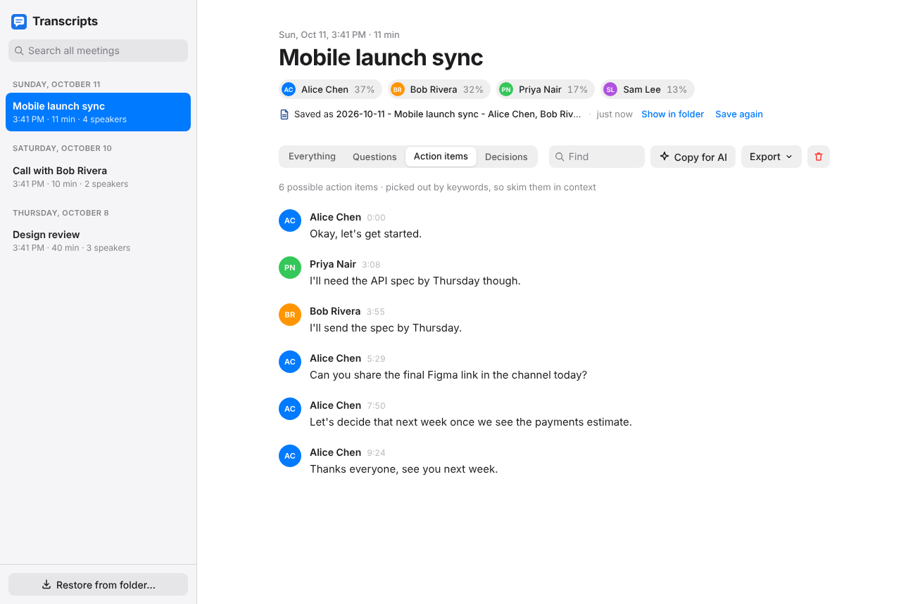
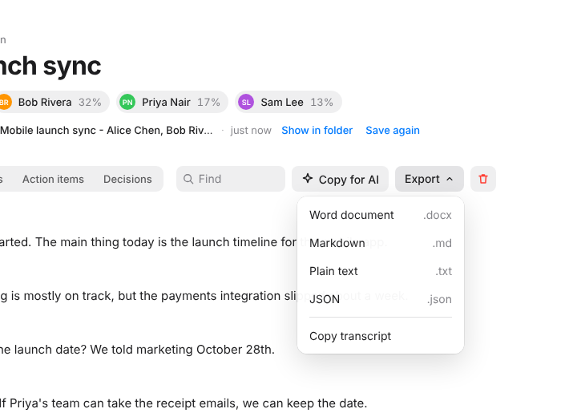
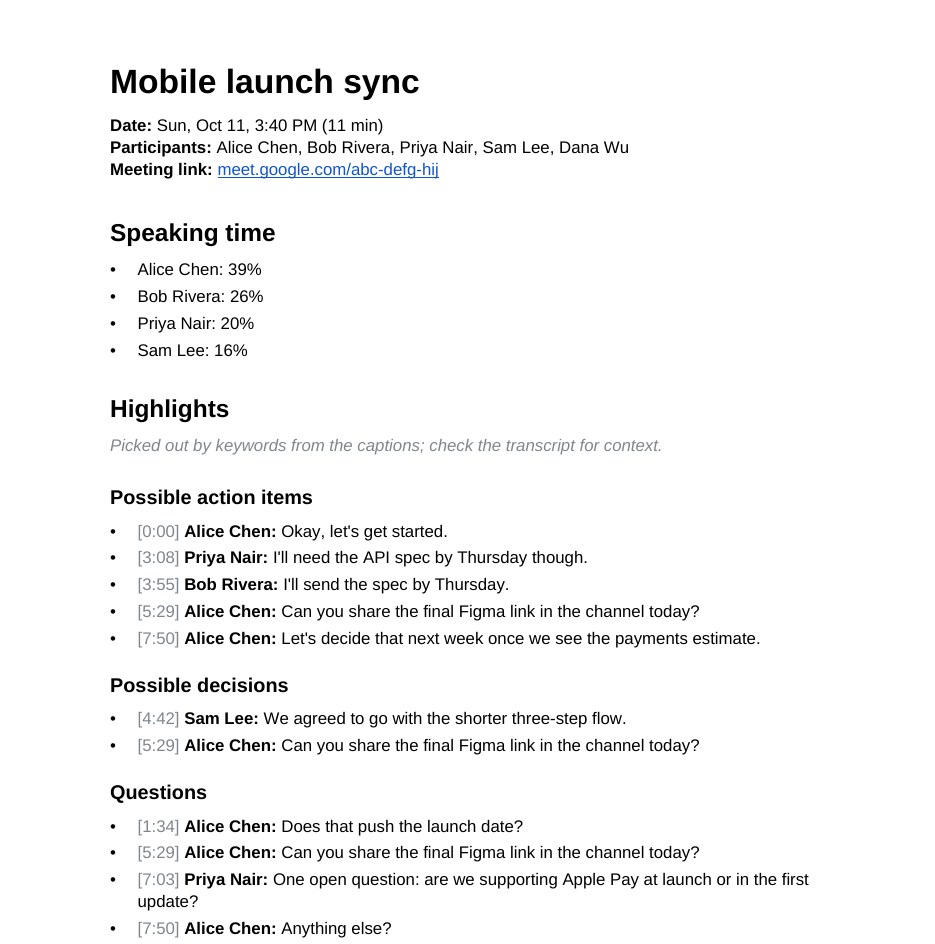
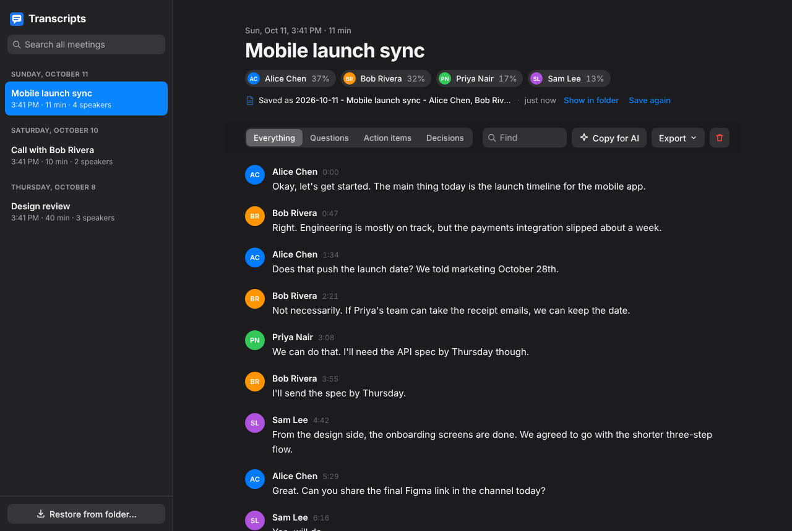
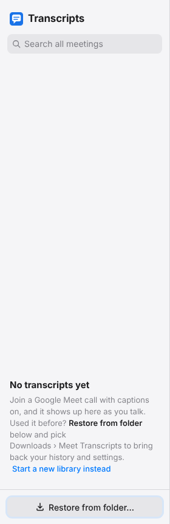

# Meet Transcripts

**Turn every Google Meet call into a searchable transcript and a Word document, automatically.**

Meet Transcripts is a free Chrome extension that quietly records the live captions of your
Google Meet calls. You don't have to remember to start it. When the call ends it saves a
tidy `.docx` with who was there, who spoke when, and the possible action items, decisions
and questions, filed in a folder for each day. No account, no sign-in, no audio recording,
no servers: everything stays on your computer.

Works on **Windows and macOS** (and Linux) in Chrome, Edge, Brave, Arc and other
Chromium browsers.



---

## Contents

- [What it does](#what-it-does)
- [Screenshots](#screenshots)
- [Install](#install)
- [Update to a new version](#update-to-a-new-version)
- [Using it](#using-it)
- [Where your files go and how they're named](#where-your-files-go-and-how-theyre-named)
- [Your history is safe: library.json](#your-history-is-safe-libraryjson)
- [Privacy](#privacy)
- [FAQ](#faq)
- [Troubleshooting](#troubleshooting)
- [Version history](#version-history)
- [For developers](#for-developers)

## What it does

- **Records automatically.** Join a Meet call and it turns captions on and starts
  recording. The toolbar badge shows `REC` while it's capturing.
- **Saves a Word document per call** to `Downloads/Meet Transcripts/<date>/`, named so you
  can find it again: `2026-10-11 - Weekly sync - Alice, Bob, Sam Lee.docx`. Calls without
  a calendar title are named after the people in them: `2026-10-11 - Call with Alice, Bob.docx`.
- **Knows who said what.** Every line has the speaker and a timestamp. Your own lines
  carry your real name instead of Meet's "You".
- **Picks out what matters.** The document and the viewer list possible **action items**,
  **decisions** and **questions**, plus each person's share of the speaking time.
- **A library for all your calls.** Search across every meeting, filter a transcript, rename
  it, export it as Word, Markdown, text or JSON, or **Copy for AI** to paste into ChatGPT,
  Claude or Gemini for a summary.
- **Survives reinstalls.** A `library.json` in the same folder keeps your history and
  settings. Remove the extension, add it back, click **Restore from folder…** and it's all
  there.
- **Private by design.** It reads the captions Meet already shows you. Nothing is uploaded
  and nobody else in the call is notified.

## Screenshots

| The toolbar popup | Dark mode |
|---|---|
|  |  |

**Action items, decisions and questions** pulled out of the transcript with one click:



**Export** to Word, Markdown, plain text or JSON, or copy it:



**The saved Word document** (first page). The full transcript follows the highlights:



**Dark mode** follows your system setting:



**After a reinstall** the library opens itself and points you to the one click that brings
your history back:



## Install

The extension isn't on the Chrome Web Store, so you load it yourself. It takes about a
minute and is the same on Windows and Mac.

1. **Download it.** Go to the [latest release](https://github.com/saigonosenpai/google-meet-transcripts-chrome-extension/releases/latest) and, under
   **Assets**, download `meet-transcripts-vX.Y.Z.zip`.
   (Or, if you use git: `git clone https://github.com/saigonosenpai/google-meet-transcripts-chrome-extension.git`;
   then load its `extension` folder in step 5.)
2. **Unzip it somewhere permanent**, for example `Documents\meet-transcripts` (Windows) or
   `~/Documents/meet-transcripts` (Mac). Chrome runs the extension from this folder, so
   don't leave it in Downloads where it might get cleaned up, and don't delete it later.
   The ZIP holds a `meet-transcripts` folder; that's the one to pick in step 5 (it directly
   contains `manifest.json`).
3. Open **`chrome://extensions`** in the address bar (Edge: `edge://extensions`).
4. Turn on **Developer mode** (the switch in the top-right corner).
5. Click **Load unpacked** and select the folder from step 2.
6. **Pin it:** click the puzzle-piece icon in the toolbar, then the pin next to
   *Meet Transcripts*, so you can see its badge during calls.

A "Meet Transcripts" tab opens to welcome you. If you've used the extension before, click
**Restore from folder…** there (see [library.json](#your-history-is-safe-libraryjson)).
Otherwise just join a Meet call.

> Chrome may show a *"Disable developer mode extensions"* notice when it starts. That's
> normal for extensions loaded this way; click the ✕ (not *Disable*).

## Update to a new version

**The short version: replace the files, click reload. Don't click Remove.**

1. Download the new version's ZIP from the [latest release](https://github.com/saigonosenpai/google-meet-transcripts-chrome-extension/releases/latest), or run
   `git pull` if you cloned it. To hear about new versions, click **Watch → Custom →
   Releases** at the top of this page.
2. Copy the new files **over your existing folder**, the one you loaded in step 5 of
   Install, replacing everything. On Windows, open the ZIP, select all, and paste into the
   folder choosing *Replace the files in the destination*. On Mac, unzip and drag the
   contents of the new `meet-transcripts` folder into yours, choosing *Replace*.
3. Open `chrome://extensions` and click the **reload arrow (↻)** on Meet Transcripts.
4. Reload any open Google Meet tabs.

Your transcripts, settings and saved files all stay exactly as they were. If a new version
changes how files are named or organized, existing files are moved over automatically.

To check which version you have, look under the extension's name in `chrome://extensions`.

**What if I removed the extension, or loaded the new version from a different folder?**
Removing an extension makes Chrome delete its stored data. Your `.docx` files and
`library.json` in Downloads are untouched, though. Load the new version, and on the tab
that opens click **Restore from folder…** and choose `Downloads › Meet Transcripts`.
Everything comes back: meetings, transcripts, names and settings.

## Using it

### During a call

Just join. The extension turns on captions (or press **c** / click the **CC** button
yourself) and starts recording. The badge on its icon tells you what's happening:

| Badge | Meaning |
|-------|---------|
| `REC` (red) | Captions are on and being recorded |
| `CC` | You're in a call but captions are off, so nothing is being recorded |
| `II` | Recording is paused |

Click the icon to **pause/resume** or open the **live transcript**, which updates as people
talk.

### When it saves

The `.docx` is saved when you leave the call or close the tab, and also after 2 minutes
without new captions, so a crash loses little. If the call carries on, the same file is
updated, so you get one file per call, never duplicates. Saving is silent: no download
pop-up in the middle of your meeting.

### Settings (in the popup)

| Setting | What it does |
|---|---|
| Turn on captions automatically | Clicks Meet's captions button for you when you join |
| Hide captions on screen | Keeps recording but hides the caption overlay |
| Your name | Used instead of "You" in transcripts. Normally read from your Google account; set it to override |
| Save each call as a .docx | Turn automatic saving on or off |
| Show folder | Opens `Meet Transcripts` in Explorer / Finder |

### The library (All Transcripts)

- Meetings grouped by day, with **search across all of them**.
- Speaker turns with timestamps (hover a timestamp for the clock time) and each person's
  share of the talking.
- **Everything / Questions / Action items / Decisions** filters. These are picked out by
  keywords, so skim them in context.
- **Find** within the transcript.
- **Copy for AI** copies the transcript with a prompt asking for a summary, key points,
  action items and open questions. Paste into any AI chat.
- **Export** as Word, Markdown, plain text or JSON, or copy the transcript.
- **Rename** by clicking the title. The `.docx` is renamed to match.
- **Show in folder** and **Save again** under the title.
- **Delete** with the trash icon (there's an **Undo**). This removes it from the library,
  not the `.docx`.

## Where your files go and how they're named

```
Downloads/Meet Transcripts/
  library.json                       ← your history and settings (see below)
  2026-10-11/
    2026-10-11 - Weekly sync - Alice, Bob, Carol, Sam Lee.docx
    2026-10-11 - Call with Alice, Bob.docx
    2026-10-11 - Call with Alice, Bob (2).docx
  2026-10-12/
    2026-10-12 - Design review - Dana, Eli, Sam Lee +3.docx
    2026-10-12 - Call with Dana.docx
```

On Windows that's `C:\Users\<you>\Downloads\Meet Transcripts\`, on a Mac
`~/Downloads/Meet Transcripts/`. The files open in Word, Pages, Google Docs and LibreOffice.

- **Scheduled meetings** (a Calendar event with a title):
  `Date - Event name - Participants`.
- **Spontaneous calls** (a shared link, "Start an instant meeting", no title):
  `Date - Call with <everyone else who joined>`. The name updates as people join. If
  nobody else joins it's `Solo call`.
- **Date** is the day the call started, `YYYY-MM-DD`, so files sort in order. Each day gets
  its own folder.
- **Participants** are everyone seen in the call plus everyone who spoke; more than four
  become `+N`.
- Two calls that would get the same name on the same day are kept apart as `(2)`, `(3)`.
- Characters Windows and macOS don't allow in file names (`: / \ * ? " < > |`) become
  spaces.

Each document contains the date, duration, participants and meeting link, speaking time
per person, the highlights, and the full transcript with timestamps.

**Want them in Google Drive, OneDrive or Dropbox?** Install that service's desktop app and
have it sync `Downloads/Meet Transcripts`. In Google Drive for desktop:
**Settings → My Computer → Add folder**. The extension needs no changes for this.

## Your history is safe: library.json

Chrome deletes an extension's stored data when you remove it. To make sure that never
costs you your history, the extension keeps a copy of everything in
**`Downloads/Meet Transcripts/library.json`**: every meeting, every transcript, the names
you gave them, and your settings. It's rewritten a few seconds after anything changes.

After a reinstall (or on a new computer, after copying the `Meet Transcripts` folder over):

1. The Transcripts tab opens on its own, with **Restore from folder…** highlighted.
2. Click it and choose your `Meet Transcripts` folder. Chrome asks you to confirm the
   upload; it isn't uploaded anywhere, it's only read by the extension.
3. Everything is back.

Restore reads `library.json` first and then any `.docx` files it doesn't already have, so
even meetings recorded before `library.json` existed come back from their Word files. It
never creates duplicates, so running it twice is harmless.

Why a click? Browsers don't let extensions read files on your computer unless you pick
them, so the restore can't happen silently. Until you restore (or choose **Start a new
library instead**), new calls are kept in a separate `library (since reinstall).json`,
which is merged in and removed when you do restore. Nothing is overwritten.

**Don't delete or move `library.json`.** The `.docx` files are a backup of the transcripts,
but only `library.json` holds your settings and edits.

## Privacy

- The extension only runs on `meet.google.com`.
- It reads the captions Meet displays in **your** browser. It doesn't record audio or
  video.
- Nothing leaves your computer: no servers, no analytics, no accounts. Files go to your
  Downloads folder and data stays in Chrome's local storage.
- Turning captions on is only visible to you. Other people in the call aren't notified.
- **Be considerate:** what others say in a meeting is theirs too. Let people know you keep
  a transcript, and follow your organization's rules and local recording laws.

Permissions it asks for, and why:

| Permission | Used for |
|---|---|
| Read and change data on meet.google.com | Reading the captions and participant names, and turning captions on |
| Downloads | Saving the `.docx` files and `library.json` to your Downloads folder |
| Storage | Keeping your transcripts and settings in Chrome |

## FAQ

**Does it turn on captions for everyone in the call?**
No. Captions in Meet are per person. Only you see them, and nobody is told.

**What if I'm invited to a meeting but don't join?**
Nothing is recorded. The extension only captures what your own browser shows while you're
in the call.

**Does it work in other languages?**
It records whatever Meet captions. Set the caption language in Meet (Settings → Captions)
to match the conversation. Accuracy is Meet's speech recognition; expect the usual errors
with names and jargon.

**Does it work in the Meet app on my phone, or in Zoom or Teams?**
No. Desktop Chrome (or another Chromium browser) with Google Meet in a tab only.

**I left and rejoined the same meeting. Do I get two transcripts?**
No. Rejoining within 10 minutes continues the same transcript and file.

**Can I move or rename the .docx files?**
Yes. Renaming in the library is best because it keeps everything in sync, but moving a
file elsewhere is fine. A later save of that call writes a fresh copy back to the folder.

**Can I use it on two computers?**
Each computer keeps its own library. To move your history, copy the `Meet Transcripts`
folder to the new computer's Downloads and use **Restore from folder…**.

## Troubleshooting

**The badge says `CC` and nothing is recorded.** Captions are off. Press **c** in Meet or
click the CC button, or turn on *Turn on captions automatically* in the popup.

**Files aren't being saved, or a Save dialog appears every time.** Chrome's *Ask where to
save each file before downloading* setting is on. The popup shows a warning with a button
to the setting (`chrome://settings/downloads`). Turn it off, or keep it and save
manually from the library.

**Nothing at all is recorded after a Meet update.** Google occasionally changes Meet's page.
Check for a newer version of the extension. If you're comfortable with code, the caption
selectors are at the top of `content.js`.

**My library is empty after updating.** You probably removed the extension or loaded the
new version from a different folder. Click **Restore from folder…** and pick
`Downloads › Meet Transcripts`.

**"This extension may have been corrupted" or it disappeared.** The folder you loaded it from
was moved or deleted. Put it back (or download it again), then **Load unpacked** again and
restore from the folder.

**My name shows as "You".** The extension reads your name from Meet's *Ready to join?*
screen. If it can't, set **Your name** in the popup.

## Version history

What changed in each version is in [CHANGELOG.md](CHANGELOG.md) and on the
[Releases](https://github.com/saigonosenpai/google-meet-transcripts-chrome-extension/releases) page.

## For developers

No build step and no dependencies: plain Manifest V3 JavaScript. The manifest has a fixed
`key`, so the extension ID (`kddloncdbcaidcdjcjpehapfbgnmicne`) and its stored data stay
the same wherever the folder lives. If you cloned the repo, load the **`extension`** folder
with **Load unpacked**.

```
extension/                 the Chrome extension (this is what the release zip contains)
  manifest.json
  background.js            toolbar badge; saves each call's .docx and library.json
  content.js               runs on meet.google.com; watches captions, participants, your name
  lib/
    shared.js              storage layout, grouping, file naming, the document layout
    docx.js                tiny dependency-free .docx writer
    docximport.js          reads saved .docx files and library.json back in, for Restore
  popup/                   the toolbar popup
  viewer/                  the transcript library and reader
  icons/
tests/
  e2e.mjs                  end-to-end test in a real Chromium
  fixtures/mock-meet.html  a page that imitates Google Meet
docs/screenshots/          images used in this README
.github/workflows/         automatic releases
CHANGELOG.md               what changed in each version (becomes the release notes)
```

`tests/e2e.mjs` launches Chromium with the extension and serves `tests/fixtures/mock-meet.html`,
a page that imitates Meet's caption DOM (in-place revisions, Meet trimming long captions,
participant tiles, leaving the call), at a meet.google.com URL. It checks the stored
transcript, the `.docx` names and day folders in a real Downloads directory, renames,
delete and undo, the "ask where to save" warning, and a full wipe-and-restore from
`library.json`:

```bash
npm i -D playwright                  # or use a global install
node tests/e2e.mjs extension /tmp    # screenshots and a copy of the saved .docx land in /tmp
```

### Releasing

Releases are automatic. `.github/workflows/release.yml` runs on every push to `main`: if the
`version` in `extension/manifest.json` has no release yet, it runs the end-to-end test, zips the
extension (without tests and screenshots), and publishes release `v<version>` with that
version's section of `CHANGELOG.md` as the notes. To ship an update:

1. Bump `version` in `extension/manifest.json` (e.g. `1.4.0` → `1.5.0`).
2. Add a `## 1.5.0` section at the top of `CHANGELOG.md`.
3. Push to `main`.

Pushes that don't change the version publish nothing. If the test fails, no release is made.

Issues and pull requests are welcome.

## License

[MIT](LICENSE)
